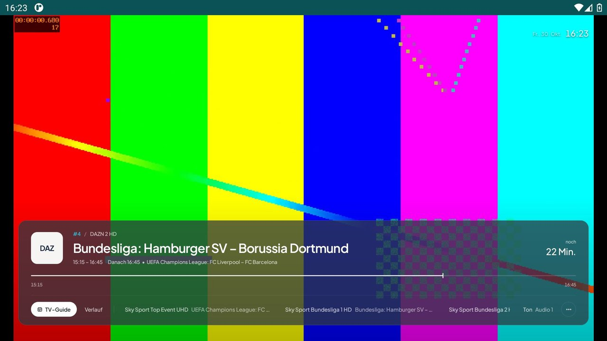
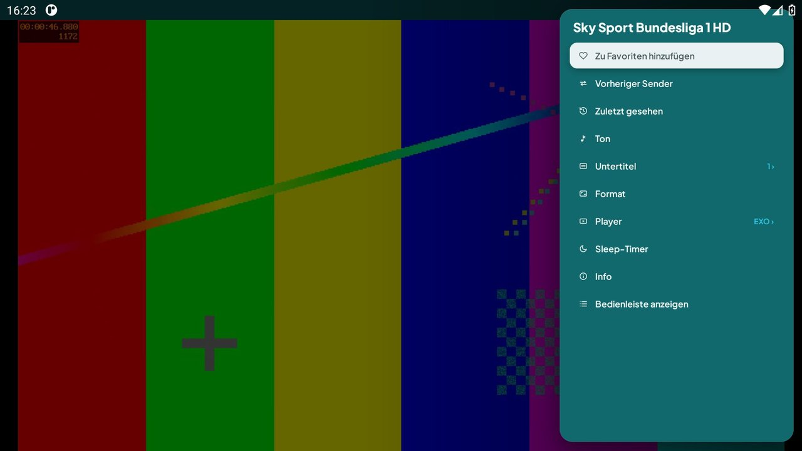
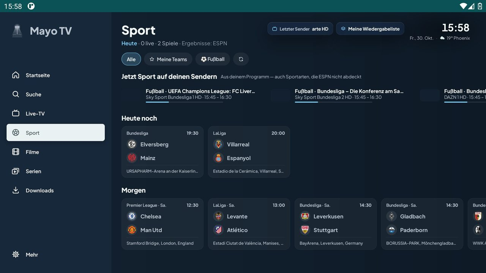
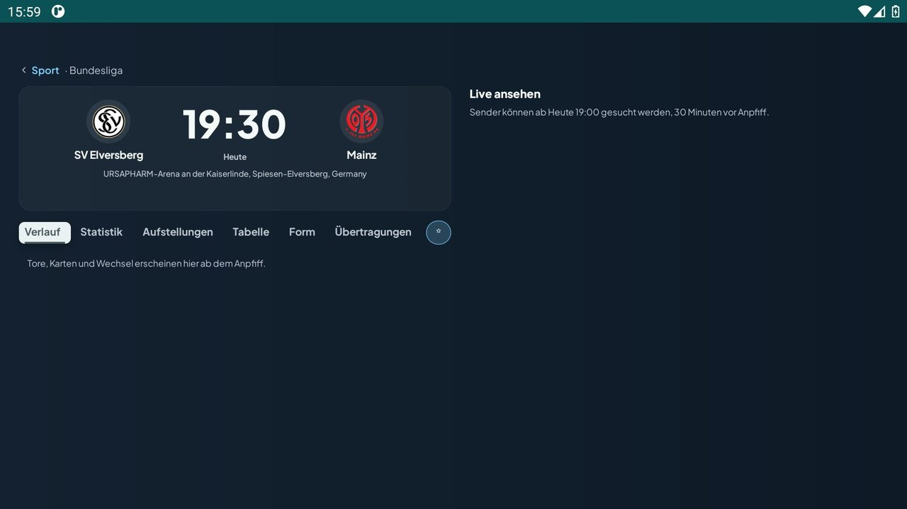
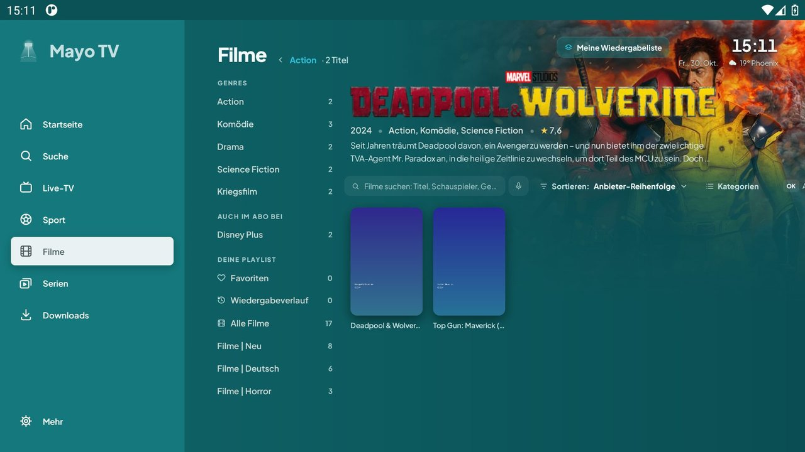
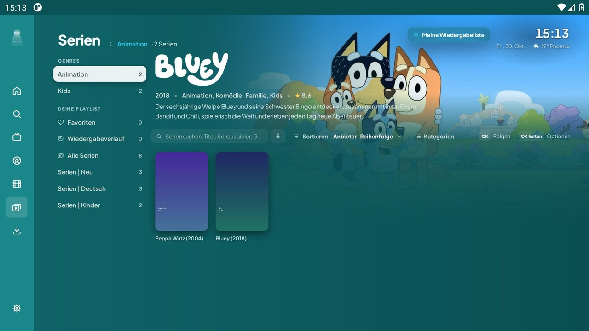
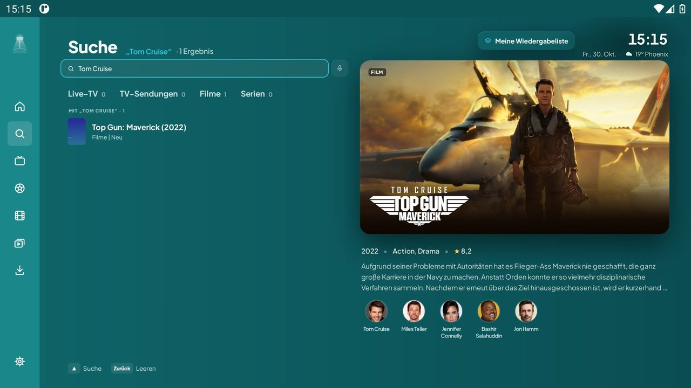
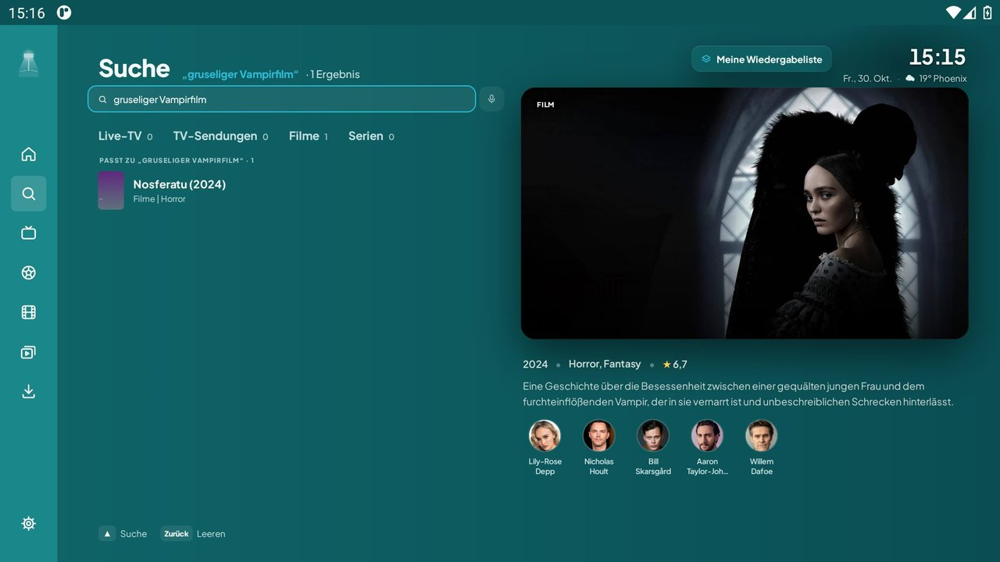
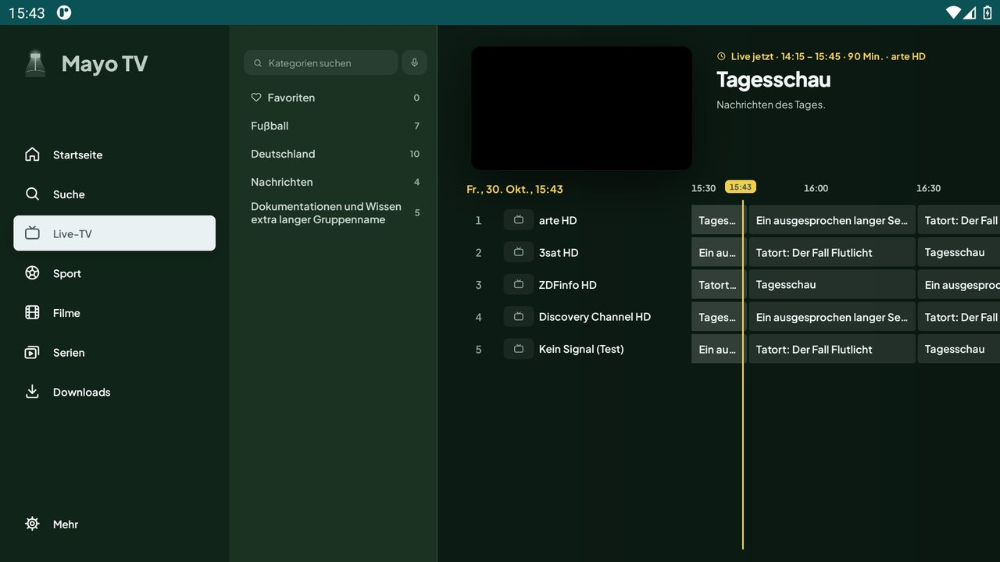

<p align="center">
  
</p>

<p align="center">
  <b>IPTV-Player für Android TV, gebaut fürs Zappen und für Fußball</b><br>
  <sub>Bedienung wie ein klassischer IPTV-Player · Fußball im Launcher · eigene Playlist (M3U, Xtream, Stalker)</sub>
</p>

<p align="center">
  <a href="https://github.com/Jonathanxoxox/tvplayer/actions/workflows/tvplayer.yml"></a>
  <a href="https://github.com/Jonathanxoxox/tvplayer/actions/workflows/smoke.yml"></a>
  
  
</p>

---

Mayo TV ist ein IPTV-Player für die Android-TV-Box. Er ist auf schnelles Umschalten mit der
Fernbedienung ausgelegt: OK öffnet im Vollbild die Senderliste mit Programm, beim Zappen erscheint
unten eine Info-Karte, Links/Rechts/Hoch/Runter tun, was man von einem IPTV-Player erwartet. Dazu
kommt, worum es eigentlich geht: **Fußball**. Mayo TV weiß, welche Teams und Ligen du verfolgst,
und zeigt laufende Spiele direkt im Launcher und auf einer eigenen Sport-Seite.

> **Hinweis:** Mayo TV ist nur ein Player. Er bringt keine Sender, Playlists oder Streams mit. Du
> fügst deine eigene Quelle hinzu und bist selbst dafür verantwortlich.

## Installieren

Die neueste APK liegt immer unter derselben Adresse:

```
https://github.com/Jonathanxoxox/tvplayer/releases/download/latest/MayoTV.apk
```

Am Fernseher z. B. mit **Downloader** öffnen, „Apps aus unbekannten Quellen“ erlauben, installieren.
Danach aktualisiert sich Mayo TV selbst: Jeder Build erscheint zusätzlich als Release `v1.0.<Lauf>`,
das der Updater in der App findet (Einstellungen → App → Nach Updates suchen).

- Paketname: `io.github.jonathanxoxox.tvplayer`, mindestens Android 8.0 (API 26).
- Seit Build v1.0.36 sind alle APKs mit demselben Schlüssel signiert. Wer eine ältere Version hat,
  deinstalliert sie einmal, danach gehen Updates einfach drüber.
- Bis Oktober 2026 hieß die App Flutlicht. Der alte Link auf `Flutlicht.apk` liefert vorerst
  dieselbe APK.

## Was Mayo TV kann

### Fußball
- **„Für dich“ im Launcher**: Eine Zeile auf dem Android-TV-Startbildschirm mit den Spielen deiner
  Teams und Ligen, die gerade laufen oder heute kommen. Ein Klick öffnet die Spielseite in der App.
- **„Favoriten“ im Launcher**: deine Lieblingssender als zweite Zeile, ohne die App erst zu öffnen.
- **Sport-Seite**: Live-Spiele, „Heute noch“ und die Ergebnisse des Tages, dazu Ligen und Tabellen.
  Sagt ehrlich, wenn die Spieldaten noch laden oder nicht erreichbar sind.
- **Spielseite**: Ablauf mit Toren und Karten, Statistik auf Deutsch, Übertragungen und die Sender
  deiner Playlist, die das Spiel zeigen. Bei einem laufenden Spiel werden sie sofort gesucht. Das
  Bild gleitet vom Spiel ins Vollbild und mit Zurück wieder zurück.
- **Gruppe „Fußball jetzt & heute“** ganz oben in Senderliste und TV-Guide, mit allen Sendern, die
  heute ein passendes Spiel zeigen. Laufende Spiele stehen vorn, Sender-Varianten (HD, UHD, Backup)
  eines Spiels stehen untereinander.
- Teams und Ligen frei wählbar unter **Einstellungen → Sport**. Ab Werk: HSV, BVB, Bayern, Liverpool,
  Barça, Bundesliga, Champions League, deutsche und dänische Nationalmannschaft.

### Fernsehen
- **Vollbild-Bedienung wie bei klassischen IPTV-Playern**: Senderliste mit Programm und Vorschau,
  Verlauf und letzte Sender, Optionen auf OK gedrückt halten. Leisten und Listen gleiten von ihrem
  Rand herein, Menüs wachsen an ihren Platz.
- **Info-Karte aus Glas** über dem unteren Bildrand: Logo, Nummer und Name, Sendung mit Zeiten und
  Fortschritt, was danach kommt, und eine Zeile zum Auswählen (TV-Guide, Verlauf, letzte Sender,
  Audio, Mehr). Die Uhr steht oben rechts.
- **Live-TV ist der TV-Guide**: Sender als Zeilen mit Zeitleiste, oben links die Vorschau mit Ton.
  Drei Ebenen (Menü → Kategorien → Guide), ◀ und Zurück gehen genau eine Ebene zurück. Das Bild
  gleitet aus der Vorschau ins Vollbild und wieder zurück. Programmdaten aus XMLTV oder, wenn die
  Playlist keins mitbringt, direkt vom Anbieter.
- Beim Umschalten zeigt Mayo TV nur das neue Bild. Erst wenn ein Sender länger als 0,6 s braucht,
  erscheint ein ruhig atmender Punkt in der Akzentfarbe.
- **Catch-up**, Aufnahmen, Multiview, Favoriten, Verlauf und Suche. Erinnerungen an Sendungen
  setzt du selbst im TV-Guide, von allein erscheint nichts.
- Zwei Wiedergabe-Engines (mpv und ExoPlayer) mit automatischem Wechsel, wenn ein Stream hakt.
- Quellen: **M3U** (URL oder Datei), **Xtream** und **Stalker/Ministra**, auch bequem vom Handy aus
  per QR-Code eingerichtet.

### Filme & Serien
- Kataloge mit Postern und Infos von TMDB, links eine Kategorien-Spalte, oben „Weiterschauen“.
  Gezeigt werden nur Titel, die deine Playlist wirklich abspielen kann.
- „Fortsetzen“ und „Weiterschauen“ spielen sofort weiter, ohne noch einmal zu fragen.
- Im Player dieselbe Glas-Karte wie beim Fernsehen: Poster, Titel, Staffel und Folge, Restzeit und
  Ende, darunter die Fortschrittslinie zum Spulen und Pause, Von vorn, Vorherige/Nächste Folge,
  Audio und Untertitel.
- „Im Abo bei“ zeigt, auf welchen Streamingdiensten ein Titel außerdem läuft.

### Suche
- Eine Suche für Sender, Filme und Serien: nach Titel, nach Schauspielern und Regie („Mit
  Tom Cruise“) und nach Beschreibung („der Film mit dem Hai“).
- Neben den Treffern läuft das Bild des Senders als Vorschau, darunter die laufende Sendung.
- **Mikrofon-Knopf** an jedem Suchfeld: Die App nimmt selbst auf und schreibt mit, auch wenn die
  Sprachsuche der Box ausgeschaltet ist.

### Fernbedienung
Jede Taste ist im Vollbild frei belegbar, **kurz drücken und gedrückt halten getrennt**
(Einstellungen → Layout → Fernbedienungs-Kurzbefehle). Ab Werk:

| Taste | Kurz | Gedrückt halten |
|------|------|------|
| OK | Info-Karte | Optionen |
| Menü | Optionen | TV-Guide |
| ◀ Links | Senderliste | – |
| ▶ Rechts | Letzter Sender | Info-Karte |
| ▲ Hoch / ▼ Runter | Sender weiter / zurück | Verlauf / Suche |
| Info, Gelb | Info-Karte | – |
| Guide, Rot, Grün | TV-Guide | – |
| Blau | Optionen | – |

Zurück im Player führt zur Senderliste, Zurück gedrückt halten aus jedem Menü zum letzten Sender.

### Look
- **Cyan Blau** als ruhiges Grundthema: Petrol-Flächen, Cyan-Akzent, heller Fokusbalken.
- Weitere **Farbthemen** unter Einstellungen → Farben: Graphit, Schiefer, Königsblau, Rasengrün,
  Bordeaux und Espresso, die schlichten Basalt, Taupe, Salbei und Pflaume und die modernen mit
  eigener Akzentfarbe: Neon, Abendrot, Flutlicht und Gletscher. Dazu ein helles Design.
- **Schrift** wählbar unter Einstellungen → Schrift & Textgröße, darunter Manrope.
- Lesbar vom Sofa: auch Kleingedrucktes ist mindestens 15 px groß, zu lange Zeilen enden in „…“.
- Alle Themen sind ruhig: keine bewegten Hintergründe, keine Pop-ups, die von selbst erscheinen,
  nur kurze Übergänge beim Wechsel zwischen Ansichten.
- Eine feste Bedienung statt vieler Layout-Varianten: schmale Menüleiste links, die beim Fokus
  aufklappt. Die App sagt überall „du“.

## Screenshots

<table>
  <tr>
    <td align="center" width="50%"><br><sub>Info-Karte aus Glas mit Programm und Auswahlzeile</sub></td>
    <td align="center" width="50%"><br><sub>Senderliste im Vollbild, Gruppe Fußball</sub></td>
  </tr>
  <tr>
    <td align="center"><br><sub>TV-Guide mit aufgeklapptem Menü</sub></td>
    <td align="center"><br><sub>Optionen, OK gedrückt halten</sub></td>
  </tr>
  <tr>
    <td align="center"><br><sub>Sport-Seite: Sport auf deinen Sendern, heute und morgen</sub></td>
    <td align="center"><br><sub>Spielseite vor dem Anpfiff</sub></td>
  </tr>
  <tr>
    <td align="center"><br><sub>Filme mit Kategorien-Spalte</sub></td>
    <td align="center"><br><sub>Serien</sub></td>
  </tr>
  <tr>
    <td align="center"><br><sub>Suche nach Schauspieler</sub></td>
    <td align="center"><br><sub>Suche nach Beschreibung</sub></td>
  </tr>
  <tr>
    <td align="center"><br><sub>Farbthema Flutlicht</sub></td>
    <td align="center"><br><sub>Fernbedienungs-Kurzbefehle</sub></td>
  </tr>
</table>

<sub>Aufgenommen im Emulator mit Test-Playlist, daher das Testbild, die schwarze Vorschau und die
Platzhalter statt Postern.</sub>

## Bauen

### In GitHub Actions

| Workflow | Wann | Was er macht |
|------|------|------|
| [`tvplayer.yml`](.github/workflows/tvplayer.yml) | Push auf `main` und `claude/**` | baut die signierte Release-APK und veröffentlicht sie als `latest` und `v1.0.<Lauf>` |
| [`smoke.yml`](.github/workflows/smoke.yml) | Push auf `main` und `claude/**` | alle JVM-Tests, Android Lint und Starttest im Emulator |
| [`i18n.yml`](.github/workflows/i18n.yml) | Pull Requests, Push auf `main` | prüft, dass keine neuen festen Texte im Code stehen (`tools/i18n/`) |
| [`screens.yml`](.github/workflows/screens.yml) | nur von Hand | fährt im Emulator per Fernbedienung durch die App und legt Screenshots auf den Zweig `screens/<Zweig>` |
| [`stress.yml`](.github/workflows/stress.yml) | nur von Hand | Härtetest im Emulator: Stream-Server weg, kein Internet, kaputte Playlist und EPG, Prozess-Tod, Tasten-Sturm, monkey. Ergebnis auf `screens/<Zweig>-haertetest` |
| [`android.yml`](.github/workflows/android.yml) | nur von Hand | OwnTVs alter Build mit Tests und Lint |

Läuft ein Workflow für einen Push, den ein neuerer Push auf demselben Zweig schon überholt hat,
überspringt er den Rest und endet grün. Die Läufe werden nicht abgebrochen, weil jeder abgebrochene
Lauf eine Mail verschickt.

Repository-Secrets:

| Secret | Wofür | Fehlt es |
|------|------|------|
| `KEYSTORE_BASE64` | Signaturschlüssel der APK | Einmal-Schlüssel, Updates über eine bestehende Installation gehen nicht |
| `TMDB_API_KEY` | Film- und Seriendaten | Metadaten müssen in der App von Hand eingerichtet werden |
| `TYPESAFE_API_KEY` | Suche nach Beschreibung | Suche nach Beschreibung ist aus |
| `ELEVENLABS_API_KEY` | Mitschreiben bei der Mikrofon-Suche | nur die Spracherkennung der Box |

### Lokal

Repository in Android Studio öffnen, Build-Variante `standard` (echte Boxen) oder `x86_64`
(Emulator) wählen, starten. Auf der Kommandozeile:

```bash
./gradlew assembleStandardRelease
```

Gebraucht wird JDK 21. Die Kernbibliothek (Datenbank, Parser, EPG, Player-Engines) lädt Gradle als
fertiges Maven-Paket. Die Schlüssel von oben lassen sich als Umgebungsvariablen
(`FLUTLICHT_TMDB_KEY`, `MAYO_TYPESAFE_KEY`, `MAYO_ELEVENLABS_KEY`) oder Gradle-Properties
(`flutlicht.tmdbKey`, `mayo.typesafeKey`, `mayo.elevenLabsKey`) mitgeben, ohne sie baut die App
trotzdem.

### Wo was liegt

```
app/src/main/java/tv/own/owntv/
├── launcher/   Launcher-Zeilen „Für dich“ und „Favoriten“, Fußball-Erkennung, Fußball-Gruppe
├── player/     Vollbild-Player, Info-Karte, Senderliste, Tastenbelegung, Ladeanzeige
├── features/
│   ├── shell/  der Rahmen der App: Menüleiste, welche Seite gerade zu sehen ist, Bild-Ebene
│   ├── epg/    Live-TV als TV-Guide
│   ├── sports/ Sport-Seite und Spielseite
│   ├── movies/ series/ vod/   Filme und Serien (TMDB)
│   ├── search/ voice/         Suche, Mikrofon, Suche nach Beschreibung
│   ├── settings/ update/      Einstellungen, Updater
│   └── …       Startseite, Multiview, Aufnahmen, Downloads, Profile
├── perf/       Startprotokoll und Frame-Messung
└── ui/         Farbthemen, Schriften, Stage-Bausteine (Leisten, Listen, Fokus), Animationen
app/src/main/res/values/strings.xml   eigene deutsche Texte (Präfix tvplayer_)
app/src/test/                         JVM-Tests
tools/smoke/                          Starttest, Screenshot-Tour und Härtetest
tools/i18n/                           Prüfung auf feste Texte im Code
tools/dm/                             vorkompiliertes Startprofil (.dm) für Updates
```

Wie man mitmacht, steht in [CONTRIBUTING.md](CONTRIBUTING.md).

## Dienste

- Film- und Seriendaten von [TMDB](https://www.themoviedb.org/). This product uses the TMDB API
  but is not endorsed or certified by TMDB.
- Spielpläne, Ergebnisse und Statistiken von ESPN.
- Untertitelsuche über [OpenSubtitles.com](https://www.opensubtitles.com/) mit deinem eigenen Konto.
- Mitschreiben bei der Mikrofon-Suche mit [ElevenLabs](https://elevenlabs.io/) Scribe, Suche nach
  Beschreibung mit [TypeSafe](https://typesafe.ai/).
- Wiedergabe über [mpv](https://mpv.io/)/[FFmpeg](https://ffmpeg.org/) und
  [Media3/ExoPlayer](https://github.com/androidx/media).

## Lizenz

GNU General Public License v3.0, siehe [LICENSE](LICENSE). Mayo TV ist eine veränderte Fassung von
[OwnTV](https://github.com/ahXN00/OwnTV) (© ahXN00, GPLv3). Geändert wurden ab Oktober 2026 unter
anderem Name und Branding, die Vollbild-Bedienung, die Launcher-Zeilen und alle Fußball-Funktionen.
Die Kernbibliothek stammt unverändert von dort.

Die mitgelieferten Schriften stehen unter der SIL Open Font License, siehe
[`extras/font-licenses/`](extras/font-licenses/).
