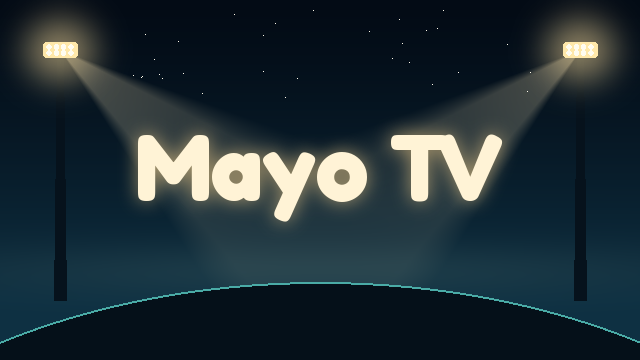
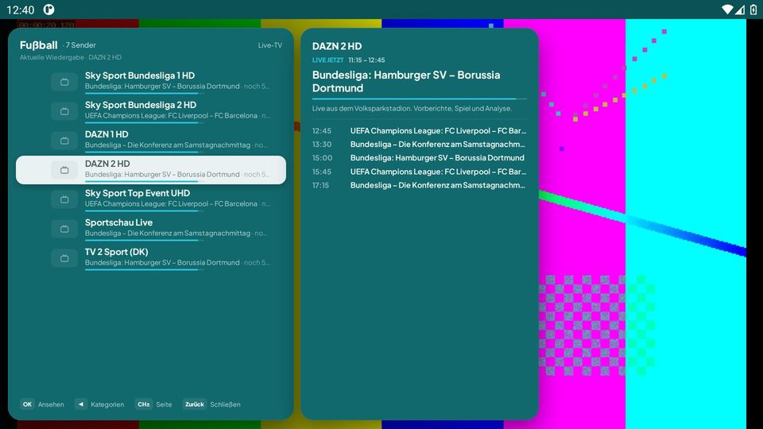
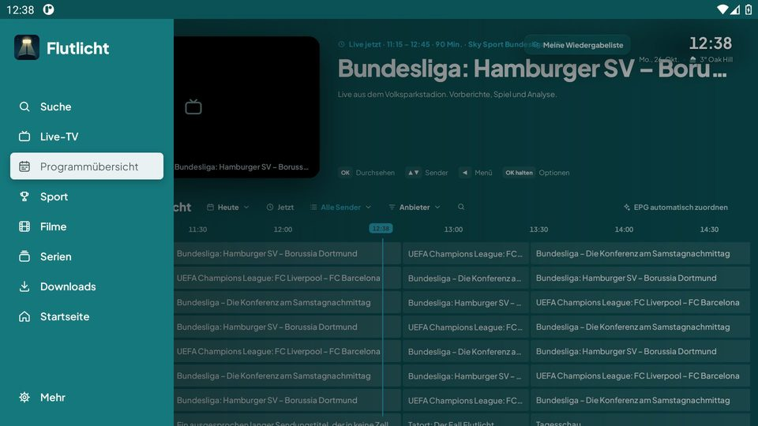
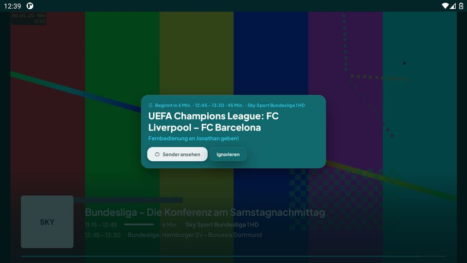
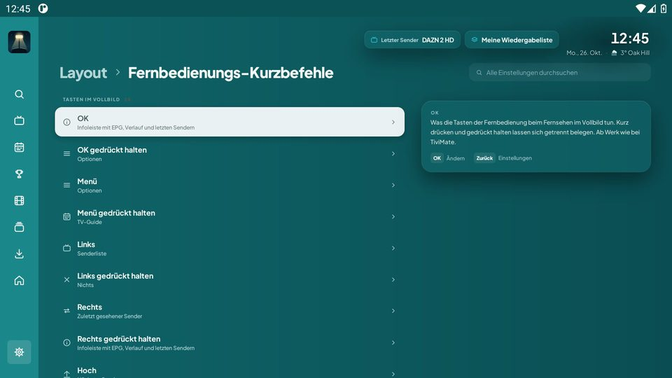

<p align="center">
  
</p>

<p align="center">
  <b>IPTV-Player für Android TV, gebaut fürs Zappen und für Fußball</b><br>
  <sub>Bedienung wie ein klassischer IPTV-Player · Fußball im Launcher · eigene Playlist (M3U, Xtream, Stalker)</sub>
</p>

<p align="center">
  <a href="https://github.com/Jonathanxoxox/tvplayer/actions/workflows/tvplayer.yml"></a>
  <a href="https://github.com/Jonathanxoxox/tvplayer/actions/workflows/smoke.yml"></a>
  
  
</p>

---

Flutlicht ist ein IPTV-Player für die Android-TV-Box. Er ist auf schnelles Umschalten mit der
Fernbedienung ausgelegt: OK öffnet im Vollbild die Senderliste mit Programm, beim Zappen erscheint
unten eine Info-Leiste, Links/Rechts/Hoch/Runter tun, was man von einem IPTV-Player erwartet. Dazu
kommt, worum es eigentlich geht: **Fußball**. Flutlicht weiß, welche Teams und Ligen du verfolgst,
zeigt laufende Spiele direkt im Launcher und erinnert dich vor dem Anpfiff.

> ⚠️ Flutlicht ist nur ein Player. Er bringt keine Sender, Playlists oder Streams mit. Du fügst deine
> eigene Quelle hinzu und bist selbst dafür verantwortlich.

## 📥 Installieren

Die neueste APK liegt immer unter derselben Adresse:

```
https://github.com/Jonathanxoxox/tvplayer/releases/download/latest/Flutlicht.apk
```

Am Fernseher z. B. mit **Downloader** öffnen, „Apps aus unbekannten Quellen“ erlauben, installieren.
Danach aktualisiert sich Flutlicht selbst: Jeder Build erscheint zusätzlich als Release `v1.0.<Lauf>`,
das der Updater in der App findet (Einstellungen → App → Nach Updates suchen).

Die App installiert sich als `io.github.jonathanxoxox.tvplayer`. Seit Build v1.0.36 sind alle APKs mit
demselben Schlüssel signiert. Wer eine ältere Version hat, deinstalliert sie einmal, danach gehen
Updates einfach drüber.

## ✨ Was Flutlicht kann

### ⚽ Fußball
- **„Für dich“ im Launcher**: Eine Zeile auf dem Android-TV-Startbildschirm mit den Spielen deiner
  Teams und Ligen, die gerade laufen oder heute kommen. Ein Klick startet den Sender.
- **„Favoriten“ im Launcher**: deine Lieblingssender als zweite Zeile, ohne die App erst zu öffnen.
- **Gruppe „⚽ Fußball jetzt & heute“** ganz oben in Senderliste und TV-Guide, mit allen Sendern, die
  heute ein passendes Spiel zeigen. Laufende Spiele stehen vorn, Sender-Varianten (HD, UHD, Backup)
  eines Spiels stehen untereinander.
- **Erinnerungen vor Anpfiff** für Spiele deiner Teams, mit „Sender ansehen“ direkt aus dem Hinweis.
- Teams und Ligen frei wählbar unter **Einstellungen → Sport**. Ab Werk: HSV, BVB, Bayern, Liverpool,
  Barça, Bundesliga, Champions League, deutsche und dänische Nationalmannschaft.

### 📺 Fernsehen
- **Vollbild-Bedienung wie bei klassischen IPTV-Playern**: Senderliste mit Programm und Vorschau,
  Info-Leiste mit EPG, Verlauf und letzten Sendern, Optionen auf OK gedrückt halten.
- **TV-Guide** (XMLTV) mit Jetzt-Markierung, mehreren EPG-Quellen und automatischer Zuordnung.
- **Catch-up**, Aufnahmen, Multiview, Favoriten, Verlauf und Suche.
- Zwei Wiedergabe-Engines (mpv und ExoPlayer) mit automatischem Wechsel, wenn ein Stream hakt.
- Quellen: **M3U** (URL oder Datei), **Xtream** und **Stalker/Ministra**, auch bequem vom Handy aus
  per QR-Code eingerichtet.

### 🎮 Fernbedienung
Jede Taste ist im Vollbild frei belegbar, **kurz drücken und gedrückt halten getrennt**
(Einstellungen → Layout → Fernbedienungs-Kurzbefehle). Ab Werk:

| Taste | Kurz | Gedrückt halten |
|------|------|------|
| OK | Info-Leiste | Optionen |
| Menü | Optionen | TV-Guide |
| ◀ Links | Senderliste | – |
| ▶ Rechts | Letzter Sender | Info-Leiste |
| ▲ Hoch / ▼ Runter | Sender weiter / zurück | Verlauf / Suche |
| Info, Gelb | Info-Leiste | – |
| Guide, Rot, Grün | TV-Guide | – |
| Blau | Optionen | – |

Zurück im Player führt zur Senderliste, Zurück gedrückt halten aus jedem Menü zum letzten Sender.

### 🎨 Look
- **Cyan Blau** als ruhiges Grundthema: Petrol-Flächen, Cyan-Akzent, heller Fokusbalken.
- **Nachtszenen** als bewegter Hintergrund hinter Menüs, Senderliste und Guide:
  **Nordlicht** (Polarlicht über Bergen, in der Ferne ein Stadion) und **Mitternacht** (Mond, lila
  Hügel, Glühwürmchen).
- **Stadion bei Flutlicht** in Live-TV und Guide, sobald Fußball läuft.
- Eigenes App-Icon, Banner und Startbildschirm.

## 📸 Screenshots

<table>
  <tr>
    <td align="center"><br><sub>Senderliste im Vollbild, Gruppe Fußball</sub></td>
    <td align="center"><br><sub>TV-Guide mit aufgeklapptem Menü</sub></td>
  </tr>
  <tr>
    <td align="center"><br><sub>Erinnerung vor Anpfiff</sub></td>
    <td align="center"><br><sub>Fernbedienungs-Kurzbefehle</sub></td>
  </tr>
</table>

<sub>Aufgenommen im Emulator mit Test-Playlist, daher das Testbild.</sub>

## 🛠️ Bauen

Gebaut wird über GitHub Actions, bei jedem Push auf `main` und auf Arbeitszweige:

| Workflow | Was er macht |
|------|------|
| [`tvplayer.yml`](.github/workflows/tvplayer.yml) | baut die signierte Release-APK und veröffentlicht sie als `latest` und `v1.0.<Lauf>` |
| [`smoke.yml`](.github/workflows/smoke.yml) | JVM-Tests (Fußball-Erkennung, Launcher-Zeilen) und Starttest im Emulator |
| [`screens.yml`](.github/workflows/screens.yml) | fährt im Emulator per Fernbedienung durch die App und legt Screenshots auf den Zweig `screens/<Zweig>` |

Signiert wird mit dem Repository-Secret `KEYSTORE_BASE64`. Fehlt es, bekommt jeder Build einen
Einmal-Schlüssel und lässt sich nicht über eine bestehende Installation updaten.

Lokal: Repository in Android Studio öffnen, Build-Variante `standard` (echte Boxen) oder `x86_64`
(Emulator) wählen, starten. Auf der Kommandozeile `./gradlew assembleStandardRelease`. Die
Kernbibliothek (Datenbank, Parser, EPG, Player-Engines) lädt Gradle als fertiges Maven-Paket.
Mindestens Android 8.0 (API 26).

### Wo was liegt

```
app/src/main/java/tv/own/owntv/
├── launcher/   Launcher-Zeilen „Für dich“ und „Favoriten“, Fußball-Erkennung, Gruppe, Erinnerungen
├── player/     Vollbild-Player, Info-Leiste, Senderliste, Tastenbelegung
├── features/   Live-TV, Guide, Filme, Serien, Einstellungen, Updater
└── ui/         Theme, Nachtszenen, Komponenten
app/src/main/res/values/strings.xml   eigene deutsche Texte (Präfix tvplayer_)
tools/smoke/                          Starttest und Screenshot-Tour
```

## 🙏 Dienste

Film- und Seriendaten kommen von [TMDB](https://www.themoviedb.org/). This product uses the TMDB API
but is not endorsed or certified by TMDB. Die Untertitelsuche nutzt
[OpenSubtitles.com](https://www.opensubtitles.com/) mit deinem eigenen Konto. Wiedergabe über
[mpv](https://mpv.io/)/[FFmpeg](https://ffmpeg.org/) und [Media3/ExoPlayer](https://github.com/androidx/media).

## 📄 Lizenz

GNU General Public License v3.0, siehe [LICENSE](LICENSE). Flutlicht ist eine veränderte Fassung von
[OwnTV](https://github.com/ahXN00/OwnTV) (© ahXN00, GPLv3). Geändert wurden ab Oktober 2026 unter
anderem Name und Branding, die Vollbild-Bedienung, die Launcher-Zeilen und alle Fußball-Funktionen.
Die Kernbibliothek stammt unverändert von dort.
